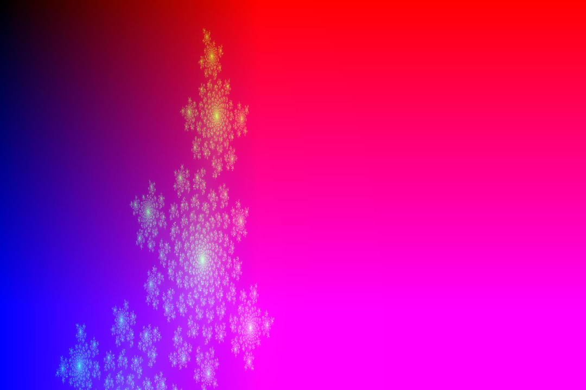

# 1920x1080 -> 1080x720

# JPEG -> JPEG
## Convolution

    
    
    
    
    
    
    

### i3
|| **Box** | **Linear** | **Hamming** | **CatmullRom** | **Mitchell** | **Gaussian** | **Lanczos3** |
|:---:|:---:|:---:|:---:|:---:|:---:|:---:|:---:|
| **avg** | 593 | 684 | 683 | 900 | 934 | 1020 | 1000 |
| **min** | 575 | 668 | 665 | 831 | 830 | 980 | 972 |
| **max** | 636 | 726 | 724 | 1150 | 1350 | 1120 | 1050 |
### i7
| | **Box** | **Linear** | **Hamming** | **CatmullRom** | **Mitchell** | **Gaussian** | **Lanczos3** |
|:---:|:---:|:---:|:---:|:---:|:---:|:---:|:---:|
| **avg** | 362 | 421 | 422 | 523 | 523 | 631 | 631 |
| **min** | 361 | 420 | 421 | 522 | 522 | 630 | 630 |
| **max** | 370 | 423 | 425 | 525 | 525 | 632 | 634 |
## Interpolation

    
    
    
    
    
    
    

### i3
 | | **Box** | **Linear** | **Hamming** | **CatmullRom** | **Mitchell** | **Gaussian** | **Lanczos3** |
|:---:|:---:|:---:|:---:|:---:|:---:|:---:|:---:|
| **avg** | 595 | 610 | 583 | 675 | 674 | 779 | 783 |
| **min** | 564 | 594 | 564 | 653 | 654 | 752 | 746 |
| **max** | 701 | 635 | 618 | 723 | 737 | 814 | 897 |
### i7
| | **Box** | **Linear** | **Hamming** | **CatmullRom** | **Mitchell** | **Gaussian** | **Lanczos3** |
|:---:|:---:|:---:|:---:|:---:|:---:|:---:|:---:|
| **avg** | 361 | 363 | 363 | 417 | 417 | 486 | 486 |
| **min** | 359 | 362 | 362 | 416 | 416 | 484 | 485 |
| **max** | 371 | 367 | 366 | 420 | 419 | 493 | 491 |
## SuperSampling

    
    
    
    
    
    
    

### i3
| | **Box** | **Linear** | **Hamming** | **CatmullRom** | **Mitchell** | **Gaussian** | **Lanczos3** |
|:---:|:---:|:---:|:---:|:---:|:---:|:---:|:---:|
| **avg** | 592 | 679 | 680 | 836 | 845 | 1010 | 1010 |
| **min** | 558 | 650 | 649 | 813 | 819 | 988 | 964 |
| **max** | 702 | 722 | 725 | 948 | 914 | 1080 | 1070 |
### i7
| | **Box** | **Linear** | **Hamming** | **CatmullRom** | **Mitchell** | **Gaussian** | **Lanczos3** |
|:---:|:---:|:---:|:---:|:---:|:---:|:---:|:---:|
| **avg** | 361 | 420 | 420 | 522 | 525 | 632 | 635 |
| **min** | 359 | 418 | 419 | 520 | 523 | 630 | 632 |
| **max** | 369 | 427 | 427 | 525 | 530 | 636 | 639 |

# JPEG -> WEBP
## Convolution

    
    
    
    
    
    
    

### i3
|| **Box** | **Linear** | **Hamming** | **CatmullRom** | **Mitchell** | **Gaussian** | **Lanczos3** |
|:---:|:---:|:---:|:---:|:---:|:---:|:---:|:---:|
| **avg** | 591 | 686 | 699 | 842 | 843 | 1010 | 1010 |
| **min** | 561 | 663 | 662 | 807 | 818 | 969 | 971 |
| **max** | 700 | 747 | 838 | 909 | 890 | 1120 | 1200 |
### i7
| | **Box** | **Linear** | **Hamming** | **CatmullRom** | **Mitchell** | **Gaussian** | **Lanczos3** |
|:---:|:---:|:---:|:---:|:---:|:---:|:---:|:---:|
| **avg** | 362 | 421 | 421 | 522 | 529 | 630 | 630 |
| **min** | 360 | 420 | 420 | 520 | 521 | 628 | 629 |
| **max** | 372 | 423 | 423 | 526 | 592 | 634 | 633 |
## Interpolation

    
    
    
    
    
    
    

### i3
 | | **Box** | **Linear** | **Hamming** | **CatmullRom** | **Mitchell** | **Gaussian** | **Lanczos3** |
|:---:|:---:|:---:|:---:|:---:|:---:|:---:|:---:|
| **avg** | 578 | 583 | 588 | 678 | 681 | 805 | 781 |
| **min** | 554 | 566 | 571 | 653 | 643 | 765 | 747 |
| **max** | 644 | 610 | 611 | 811 | 884 | 967 | 866 |
### i7
| | **Box** | **Linear** | **Hamming** | **CatmullRom** | **Mitchell** | **Gaussian** | **Lanczos3** |
|:---:|:---:|:---:|:---:|:---:|:---:|:---:|:---:|
| **avg** | 362 | 364 | 365 | 421 | 422 | 490 | 490 |
| **min** | 361 | 363 | 363 | 419 | 421 | 488 | 486 |
| **max** | 367 | 367 | 371 | 424 | 426 | 500 | 493 |
## SuperSampling

    
    
    
    
    
    
    

### i3
| | **Box** | **Linear** | **Hamming** | **CatmullRom** | **Mitchell** | **Gaussian** | **Lanczos3** |
|:---:|:---:|:---:|:---:|:---:|:---:|:---:|:---:|
| **avg** | 550 | 635 | 637 | 783 | 782 | 940 | 940 |
| **min** | 540 | 628 | 630 | 774 | 774 | 932 | 933 |
| **max** | 681 | 642 | 660 | 842 | 813 | 956 | 962 |
### i7
| | **Box** | **Linear** | **Hamming** | **CatmullRom** | **Mitchell** | **Gaussian** | **Lanczos3** |
|:---:|:---:|:---:|:---:|:---:|:---:|:---:|:---:|
| **avg** | 362 | 421 | 421 | 523 | 523 | 631 | 637 |
| **min** | 361 | 421 | 420 | 522 | 522 | 630 | 630 |
| **max** | 369 | 423 | 423 | 527 | 529 | 633 | 675 |
